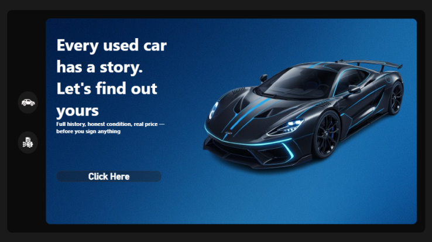

# 🚗 Used Car Market Pulse: What's for Sale, and at What Price?

An end-to-end data analysis and business intelligence project exploring used car market dynamics, pricing drivers, and brand dominance using **Power BI**.

---

## 📊 Project Overview
Navigating the used car market can be overwhelming. This project aims to bring transparency to buyers and sellers by analyzing **1,129 cars** to uncover true market conditions, depreciation rates, and the core factors influencing a car's resale value before any commitment is made.

---

## 🖼️ Dashboard Preview

### 1. Home Page

  

### 2. Market Pulse & Distribution (Dashboard 1)

  

### 3. Price Drivers & Deep Analysis (Dashboard 2)

  

---

## 🔍 Key Insights & Findings

1. **Market Concentration by Price:**
   * The market is heavily skewed toward **Economy ($6K–$12K)** (411 cars) and **Budget (<$6K)** (326 cars) segments, representing over **65%** of total listings, while Luxury ($50K+) and Premium ($25K–$50K) occupy a smaller niche.
   * The overall **Median Price** sits at **$8.32K** (compared to an **Average Price** of **$19.91K**), highlighting how high-end luxury outliers skew the average upward.

2. **Dominant Brands & Luxury Outliers:**
   * **Maruti** (254) and **Hyundai** (240) dominate market volume significantly, followed by **Honda** (130) and **Mercedes-Benz** (96), reflecting high liquidity and accessibility.
   * On the pricing spectrum, **Lamborghini** ($435.94K avg) and **Porsche** ($152.58K avg) command the highest average resale values.

3. **Fuel Type & Transmission Dynamics:**
   * **Petrol** powers **66.34%** of the used car market, followed by **Diesel** (**32.15%**) and **CNG** (**1.51%**).
   * **41.90%** of listed vehicles feature an **Automatic** transmission, which commands a substantial price premium over Manual variants across both Diesel ($42K vs. $9K) and Petrol ($35K vs. $6K) categories.

4. **Depreciation & Vehicle Age:**
   * Listings peak sharply around **2018** (174 cars), indicating that 6-to-8-year-old vehicles make up the bulk of active supply.
   * Cars experience steep depreciation during their first 3–5 years of ownership before value loss stabilizes into a gradual decline.

5. **Engine Power vs. Resale Value:**
   * With an average power of **126.16 BHP** and average mileage of **51.98K KMs**, scatter analysis confirms a strong positive correlation between higher BHP and higher resale price, particularly within Petrol and Diesel segments.

---

## 💡 Recommendations

* **For Buyers:** Focus on **5-to-8-year-old vehicles** where initial steep depreciation has already occurred, maximizing value per dollar. Choosing high-volume brands like **Maruti** or **Hyundai** ensures better resale liquidity and lower maintenance costs.
* **For Dealerships & Sellers:** Prioritize inventory in the **Petrol Economy ($6K–$12K)** and **Budget (<$6K)** segments for rapid inventory turnover, while pricing Automatic variants competitively to capture higher profit margins.

---

## 📂 Repository Structure
* `Used Car_row_data.csv` — Raw dataset prior to cleaning and transformation.
* `Used_car_clean_data.xlsx` — Cleaned and profiled dataset ready for modeling.
* `power BI project.pbix` — Complete interactive Power BI report file.
* `HomePage.png`, `Dashboard1.jpg`, `Dashboard 2.png` — High-resolution dashboard screenshots.

---

## 🛠️ Tools & Technologies Used
* **Power BI Desktop:** Interactive dashboard design, DAX measures, data modeling, and custom navigation buttons.
* **Excel / Power Query:** Data cleaning, outlier handling, and exploratory data analysis.
* **UI/UX Design:** Custom dark-mode theme layout and visual hierarchy.

---

## 🚀 How to View & Use
1. Clone this repository or download `power BI project.pbix`.
2. Open the file in **Power BI Desktop**.
3. Use the left-hand navigation icons and top slicers (`car_brand`, `fuel_type`, `transmission`, `ownership`, `manufacturing_year`) to explore the data interactively.
